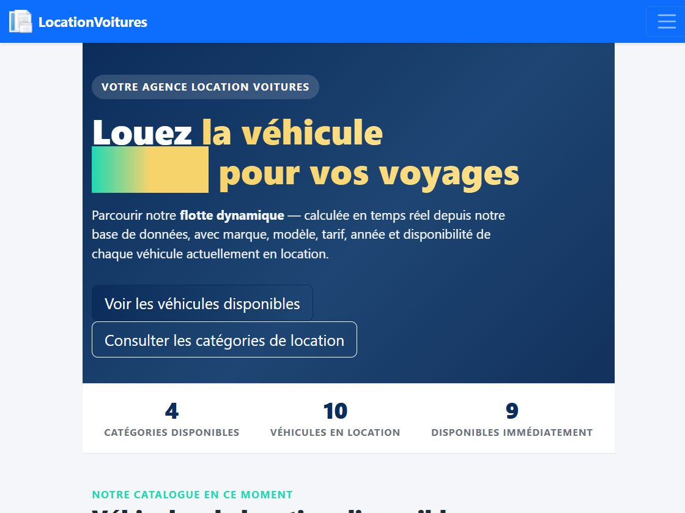
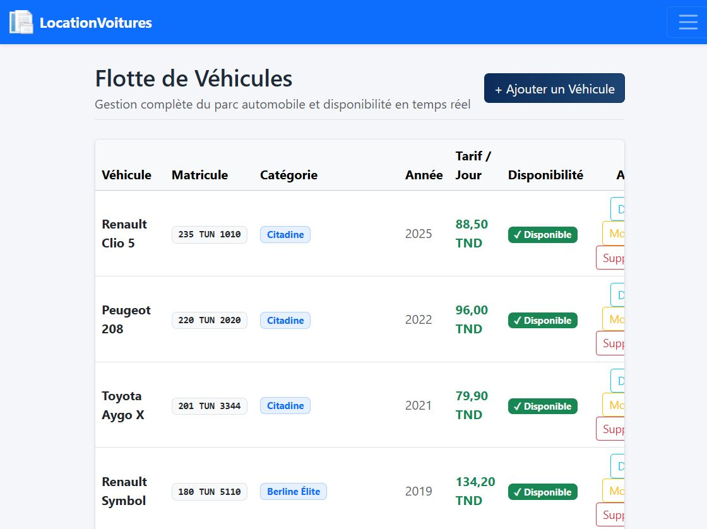
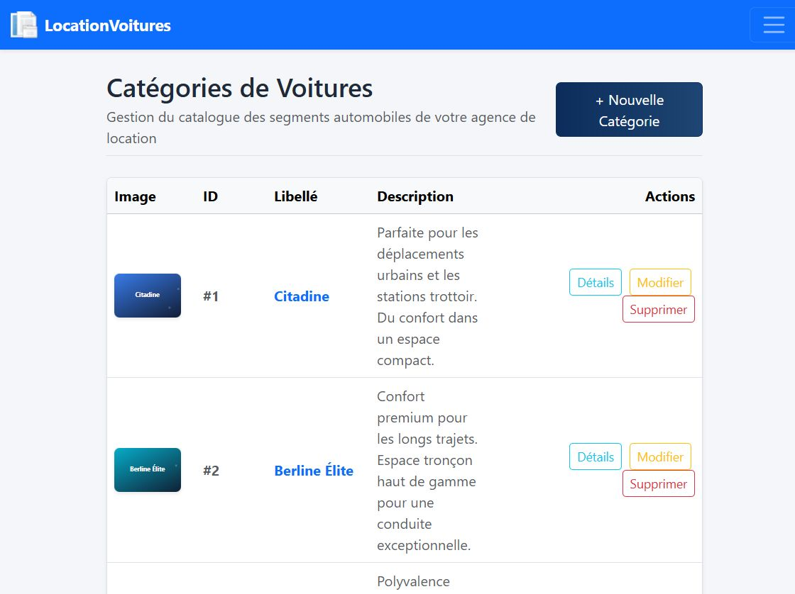

# 🚗 LocationVoitures — Agence de location de voitures

Site web **ASP.NET Core 10 MVC (.NET 10)** — suite complète du TP Séance 2 : persistance SQL Server LocalDB, **Repository Pattern**, téléversement d'images et front vitrine dynamique.

Votre agence **LocationVoitures** met en vente une flotte dynamique : homepage vitrine exploitant la base, back-office complet pour gérer les **catégories** et la **flotte de véhicules**, avec upload d'images sur disque.

## 🖸 Captures d'écran

| Page | Description |
| :-- | :-- |
|  | **Accueil vitrine dynamique** — Hero animé, stats en temps réel (4 catégories, 10 véhicules, 9 disponibles) et grille de cartes de véhicules |
|  | **Flotte de véhicules** — Back-office avec tableau dynamique : véhicule, matricule, catégorie (chargée via `.Include`), année, tarif et badge disponibilité |
|  | **Gestion des catégories** — Back-office avec tableau, images et détails des catégories |

## 🛠️ Stack technique

- **ASP.NET Core 10.0 MVC** (.NET 10, C#)
- **Entity Framework Core 10.0.15** avec provider **SqlServer** + **LocalDB** (`(localdb)\mssqllocaldb`)
- **Repository Pattern** : `@@IREPOCAT@@` + `@@REPO@@` (+ `@@VIREPOCAT@@` + `@@VREPOCAT@@` avec `Include`)
- **Relation 1-N** : clé étrangère `@@FKID@@` sur `Voiture` (FK) + propriété de navigation `Voitures` (inverse de `CategoryVoiture.Voitures`)
- **Upload d'images** : `IFormFile` → écriture sur disque `wwwroot/uploads/categories/category_<id>.<ext>` + URL relative en base

## ⚙️ Installation & Lancement

```bash
# Lancement direct :
dotnet run --urls https://localhost:5051
```

Ou avec **Visual Studio 2022** : bouton **Démarrer (F5)** → page `https://localhost:5051/`.

> L'application démarre en **Development**, amorce le schéma SQL (`Database.Migrate()`) et amorce les données de démonstration si le catalogue est vide (4 catégories + 10 véhicules, cf. `Program.cs`).

## 🗃️ Base de données LocalDB

Chaîne de connexion (`appsettings.json`) :

```
Server=(localdb)\mssqllocaldb;Database=LocationVoituresDb;Trusted_Connection=True;MultipleActiveResultSets=true;TrustServerCertificate=True
```

Commandes EF (Séance 2 Partie 2 & 3) :

```bash
# PMC
Add-Migration InitialCreate
Update-Database

# CLI
dotnet ef migrations add InitialCreate
dotnet ef database update
```

> ⚠️ Note : une base `LocationVoituresDb` existait déjà dans LocalDB avec une migration antérieure (`InitialCreateCategory`). Elle a été recrée proprement avec `InitialCreate` + seed.

## 🧪 Vérifications effectuées (Séance 2)

- [x] Projet MVC (.NET 10) + EF Core 10
- [x] Packages NuGet : `SqlServer`, `Tools`, `Design`
- [x] Chaîne de connexion LocalDB dans `appsettings.json`
- [x] `ApplicationDbContext` : `DbSet<CategoryVoiture>` (`@@DBSET1@@`) + `DbSet<Voiture>` (`@@DBSET2@@`), enregistré dans `Program.cs`
- [x] Repository Pattern : `@@IREPOCAT@@` + `@@REPO@@` (GetAll / GetById / Add / Update / Delete / Exists) + `@@VIREPOCAT@@` + `@@VREPOCAT@@` avec `.Include`
- [x] Modèle `CategoryVoiture` (identifiant, libellé, description, URL image, collection de navigation)
- [x] Relation 1-N : `Voiture.@@FKID@@` (FK) — `Voitures` sur `CategoryVoiture`
- [x] Upload d'images (Create / Edit) : `IFormFile` → écriture sur disque `category_<id>` + URL relative en base
- [x] Vues Razor complètes : Index / Create / Edit / Details / Delete pour catégories et voitures avec validation
- [x] Liens de navigation mis à jour dans `Views/Shared/_Layout.cshtml` : Accueil / Flotte / Catégories
- [x] Page d'accueil (Home) dynamique — véhicules présents en base
- [x] Migrations Code-First + `Update-Database` LocalDB
- [x] Tests CRUD — via navigateur : création, modification, suppression sans erreur de console

## 📁 Structure du projet

```
LocationVoitures.Web/
├── Program.cs                      # DI + Database.Migrate() + seed
├── appsettings.json                # Connexion LocalDB
├── Controllers/
│   ├── HomeController.cs
│   ├── @@CATCTRL@@                 # CRUD catégories + upload images
│   └── @@VOICTRL@@                 # CRUD flotte (+ SelectList catégories)
├── Data/
│   └── ApplicationDbContext.cs     # DbSet<CategoryVoiture>, DbSet<Voiture>
├── Models/
│   ├── CategoryVoiture.cs
│   └── Voiture.cs
├── Repositories/
│   ├── @@IREPOCAT@@.cs + @@REPO@@.cs
│   └── @@VIREPOCAT@@.cs + @@VREPOCAT@@.cs (Include)
├── Views/
│   ├── Home/Index.cshtml           # Vitrine dynamique
│   ├── @@CATFOLDER@@/{Index, Create, Edit, Details, Delete}.cshtml
│   ├── @@VOIFOLDER@@/{Index, Create, Edit, Details, Delete}.cshtml
│   └── Shared/_Layout.cshtml       # Navbar + footer
├── wwwroot/
│   ├── css/site.css
│   ├── uploads/categories/          # Images de catégories (category_<id>.svg)
│   └── lib/bootstrap/, lib/jquery/
└── Migrations/InitialCreate.cs
```

## 🔄 Workflow Git

```bash
git add -A
git commit -m "TP Séance 2 : LocationVoitures.Web — MVC .NET 10 + EF Core 10 LocalDB + Repository Pattern + Upload images"
git push -u origin main
```

---

💼 Agence **LocationVoitures** — suite complète du TP Séance 2.

TP Séance 2 : https://cours-web.onebyte.tn/TP_S2/TP_ASPNET_MVC_Seance2.html

